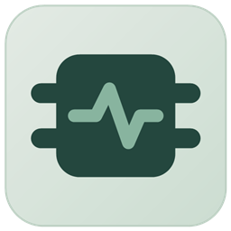
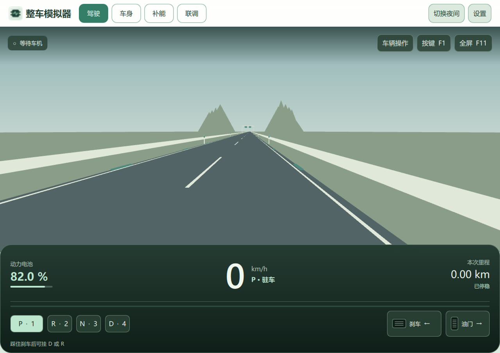

<h1 align="center">QML Cockpit Simulator</h1>

<strong>面向智能座舱的整车模拟与联调工具</strong>

---

  
  
  
  

---

  <a href="#快速开始">下载</a> · <a href="#实操演示">实操演示</a> · <a href="#主要功能">主要功能</a> · <a href="https://github.com/woniu101/qml-cockpit">车机项目</a>

## 快速开始

下载 [Windows x64 便携包](https://github.com/woniu101/qml-cockpit-simulator/releases/download/v0.2.0/QmlCockpitSimulator-v0.2.0-windows-x64.zip)，解压后运行 `QmlCockpitSimulator.exe`。打开[同版本车机](https://github.com/woniu101/qml-cockpit/releases/tag/v0.2.0)，在顶栏选择「外部模拟器」。

默认使用 **← 刹车 / → 油门**，**1 / 2 / 3 / 4** 切换 P / R / N / D，**F1** 查看或修改按键。

## 实操演示

[观看或下载车机与模拟器实操演示](https://github.com/woniu101/qml-cockpit/releases/download/v0.2.0/QML-Cockpit-Demo.mp4)。片中右后窗从 0% 调到 35%，可以看到指令下发、开度变化和回传。

## 主要功能

- **驾驶模拟**：操作挡位和踏板，实时更新车速、里程和电量。
- **车身与补能**：模拟门窗、门锁、后视镜、插枪和充电流程。
- **联调诊断**：查看指令回执，可模拟遥测暂停、延迟、拒绝和断线。

## 从源码构建

使用 Qt 6.12、MSVC 2022 x64 和 CMake，执行 `scripts/build.cmd`、`scripts/run.cmd`。其他环境按本机安装路径调整 CMake 预设和脚本。[查看联调协议](protocol/README.md)。

## 许可

项目源码采用 [GPL-3.0-only](LICENSE)。Qt 等组件的许可与源码见[第三方声明](THIRD_PARTY_NOTICES.md)。
